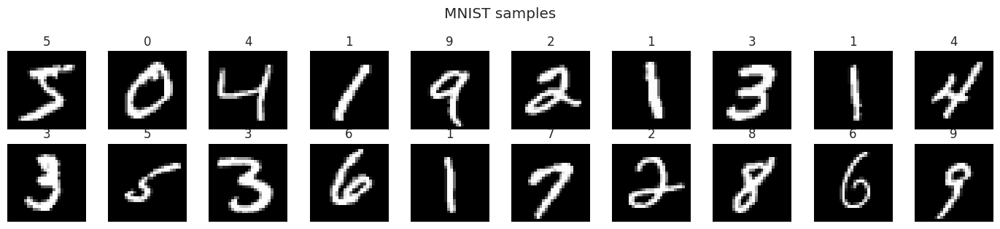
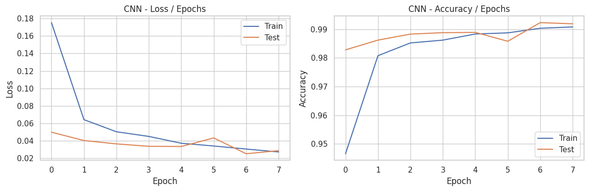
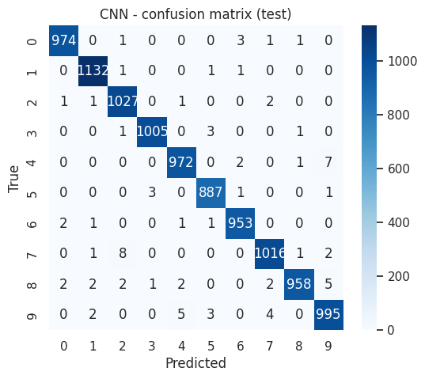
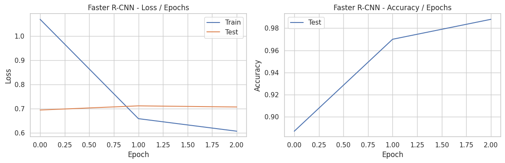
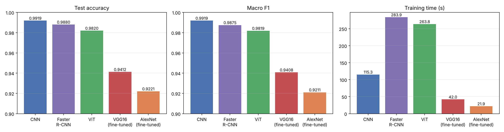
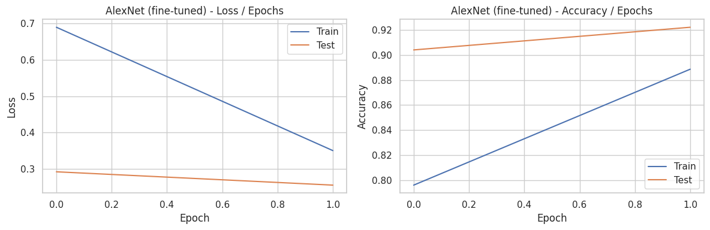
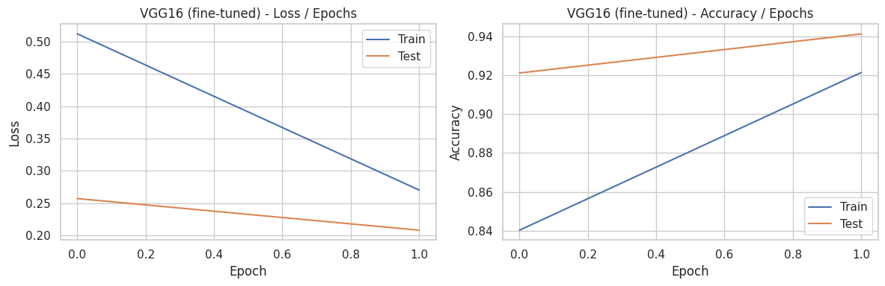
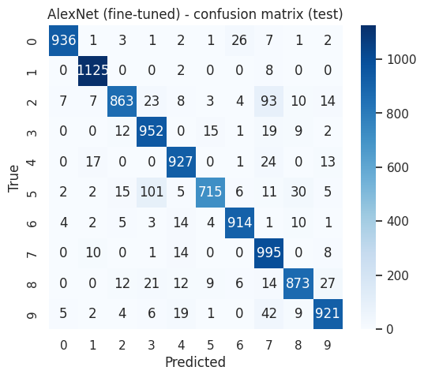
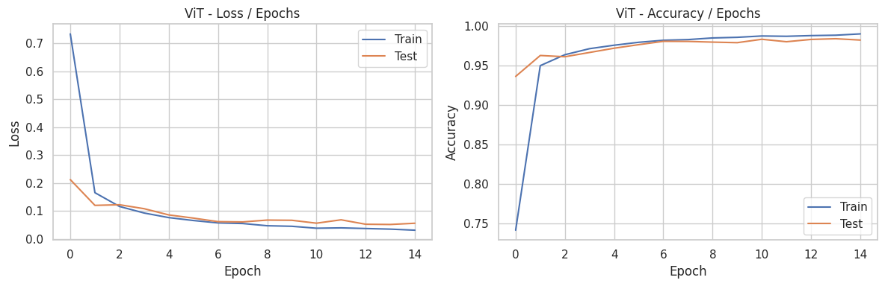
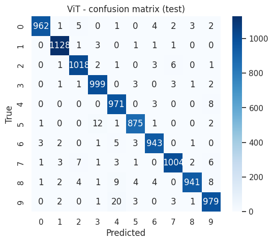

# Deep Learning – Lab 2: Computer Vision on MNIST (CNN, Faster R-CNN, Transfer Learning, ViT)

**Université Abdelmalek Essaadi – FSTT – Département Génie Informatique**
**Course:** Deep Learning – Pr. Elaachak Lotfi
**Student:** Soukaina Zahti

---

## 1. Objective

Get familiar with PyTorch for computer vision, **in GPU mode**, by building and comparing on MNIST:

1. a **CNN** built from scratch,
2. a **Faster R-CNN**,
3. **VGG16** and **AlexNet** pretrained on ImageNet and fine-tuned to MNIST,
4. a **Vision Transformer (ViT)** built from scratch.

## 2. Environment and reproducibility

- Google Colab, **GPU: Tesla T4**, PyTorch 2.11.0+cu130, torchvision 0.26.0+cu130, scikit-learn.
- Global seed = 42. All code, outputs and plots are in `Lab2.ipynb`.
- MNIST is loaded with `torchvision.datasets.MNIST` (the same data as the Kaggle `hojjatk/mnist-dataset` files).
- All models share one training loop (`fit_clf`) and one results dictionary, so the comparison uses identical metrics. **Training time** counts only the training passes (with `torch.cuda.synchronize()`), not the evaluation.
- All results come from **one run, one seed**.

## 3. Dataset and EDA

MNIST: **60,000 training and 10,000 test images**, 28×28 grayscale, 10 digit classes.



- Classes are **roughly balanced** (from 5,421 images for digit 5 to 6,742 for digit 1), so, unlike Lab 1, there is no imbalance problem and **accuracy is a valid metric**; F1 (macro) is reported as well.
- Preprocessing: pixels scaled to [0, 1] and standardized with the MNIST mean (0.1307) and standard deviation (0.3081). For the pretrained networks the images are resized to 64×64, converted to 3 channels and normalized with ImageNet statistics.

---

## 4. Part 1.1 – CNN classifier

### Architecture and hyper-parameters

```
Input 1×28×28
Conv(1→32, k=3, s=1, p=1) → BatchNorm → ReLU → MaxPool(2)    → 32×14×14
Conv(32→64, k=3, s=1, p=1) → BatchNorm → ReLU → MaxPool(2)   → 64×7×7
Flatten (3136) → Linear(3136→128) → ReLU → Dropout(0.3) → Linear(128→10)
```

| Hyper-parameter | Value |
|---|---|
| Kernel size / stride / padding | 3×3 / 1 / 1 (padding keeps the size; the output size follows `(W − K + 2P)/S + 1`) |
| Pooling | MaxPool 2×2 (halves height and width) |
| Filters | 32, then 64 |
| Fully connected | 3136 → 128 → 10 |
| Optimizer | Adam, learning rate 1e-3 |
| Regularization | BatchNorm, Dropout 0.3, weight decay 1e-4 |
| Batch size / epochs | 128 / 8 |
| Loss | Cross-entropy |
| Device | GPU (Tesla T4) |
| Parameters | 421,834 (≈ 0.42 M) |

### Results

| Metric | Value |
|---|---|
| Test accuracy | **0.9919** |
| Macro F1 | **0.9919** |
| Test loss | 0.0286 |
| Training time (8 epochs, GPU) | 115.3 s (≈ 14.4 s per epoch) |

Per class, F1 ranges from 0.9856 (digit 9) to 0.9956 (digit 1).




**Interpretation.** Loss drops fast in the first two epochs (train 0.175 → 0.064) and then decreases slowly. Test accuracy goes from 98.3 % after the first epoch to 99.2 % at the end, with a small dip at epoch 6 (98.6 %) that recovers, which is normal noise with 10,000 test images. Train and test curves stay very close (train accuracy 99.1 %, test 99.2 %): **no overfitting**. Test accuracy is even slightly above train accuracy early on, because train metrics are averaged over the epoch while the weights are still improving, and Dropout is active during training. The confusion matrix is almost diagonal: only 81 of 10,000 images are wrong; the most frequent errors are 7→2 (8 times), 4→9 (7), and 8→9 and 9→4 (5 each), i.e. visually similar shapes.

---

## 5. Part 1.2 – Faster R-CNN

### How MNIST was adapted

Faster R-CNN is an object **detection** model (backbone → region proposal network → ROI head that classifies and refines boxes). MNIST has no boxes, so the task was converted into detection:

- **Box** = tightest rectangle around the pixels above 0.2 (computed automatically), one box per image.
- **Label** = digit + 1 (label 0 is reserved for the background in torchvision, so 11 classes).
- **Predicted digit** = label of the detection with the highest score (an image with no detection counts as an error).
- Lightweight model: `fasterrcnn_mobilenet_v3_large_320_fpn` with an ImageNet-pretrained backbone, input size 128 px, **10,000 training images and 2,000 test images** (a subset, for speed), **18,976,354 parameters** (≈ 19 M).

### First run: training diverged, then fixed

In the first run (SGD, learning rate 0.005, no warm-up) the loss became `NaN` from the first epoch and accuracy stayed at 0 (exploding gradients). The fix was a **lower learning rate (0.002), a linear warm-up over the first 200 iterations, gradient clipping (max norm 10)** and a check that stops training on a non-finite loss. A diagnostic on the first batch confirmed that the setup itself was sound: the boxes were finite and the initial losses were finite and plausible (classification 2.389 ≈ ln 11, i.e. chance level for 11 classes; objectness 0.690 ≈ ln 2; box regression 0.166; RPN box regression 0.005).

### Results (3 epochs)

| Metric | Value |
|---|---|
| Test accuracy (2,000 test images) | **0.9880** |
| Macro F1 | **0.9875** |
| Test detection loss | 0.7077 (not comparable with cross-entropy) |
| Training time (3 epochs, 10,000 images each, GPU) | 283.9 s (≈ 94.6 s per epoch, ≈ 9.5 s per 1,000 images) |
| Parameters | 18,976,354 (≈ 19 M) |

| Epoch | Train loss | Test loss | Test accuracy |
|---|---|---|---|
| 1 | 1.0697 | 0.6951 | 0.8870 |
| 2 | 0.6594 | 0.7124 | 0.9700 |
| 3 | 0.6077 | 0.7077 | 0.9880 |



**Interpretation.** Train loss decreases (1.07 → 0.61) and test accuracy climbs quickly (88.7 % → 97.0 % → 98.8 %), so the model learns the task well in only three epochs, helped by the ImageNet-pretrained backbone. Accuracy is still rising at epoch 3 (+1.8 points), so the model is **not fully converged**. The test loss stays flat at about 0.70 to 0.71 although accuracy keeps improving: the detection loss is a sum of several terms (objectness, box regression, classification) and I did not break it down, so it should be read as a trend only; accuracy is the more reliable indicator here. Note that the curves have only 3 points.

---

## 6. Part 1.3 – Comparison CNN vs Faster R-CNN

| Model | Params (M) | Test accuracy | Macro F1 | Test loss | Training time (s) | Epochs × images |
|---|---|---|---|---|---|---|
| CNN | 0.42 | **0.9919** | **0.9919** | 0.0286 (cross-entropy) | 115.3 | 8 × 60,000 |
| Faster R-CNN | 18.98 | 0.9880 | 0.9875 | 0.7077 (detection loss, not comparable) | 283.9 | 3 × 10,000 |



Observations:

- **Accuracy:** the CNN is 0.39 point better (99.19 % vs 98.80 %). The Faster R-CNN was evaluated on a 2,000-image test subset, where accuracy has a standard error of about ±0.25 point, so the difference is small and not clearly significant. It also used an ImageNet-pretrained backbone and 6 times fewer training images.
- **Cost:** Faster R-CNN has about **45 times more parameters** (19 M vs 0.42 M) and is about **39 times slower per training image** (9.5 s vs 0.24 s per 1,000 images). Its total time (284 s vs 115 s) looks closer only because it saw 30,000 image-passes instead of 480,000.
- **Design:** the CNN is built for classification (one forward pass). Faster R-CNN first proposes regions, then classifies and refines boxes, which is useful only when objects must be **located**. MNIST has one centred digit per image, so this machinery brings no benefit here.
- **Loss:** the Faster R-CNN loss sums detection losses (objectness + box regression + classification), so it **cannot be compared numerically** with the CNN cross-entropy.
- **Conclusion:** for single-digit classification, the CNN gives slightly better accuracy at a small fraction of the cost.

---

## 7. Part 1.4 – Fine-tuning VGG16 and AlexNet

### Strategy

Both networks were pretrained on ImageNet. Images were resized to 64×64, replicated to 3 channels and normalized with ImageNet statistics. The last layer (1000 → 10 classes) was replaced, the **convolutional part (`features`) was frozen** and the three dense layers were trained: Adam, lr 1e-3, **2 epochs on a 20,000-image subset** (for speed), evaluated on the full 10,000-image test set.

| Model | Total params (M) | Trainable params (M) |
|---|---|---|
| AlexNet | 57.04 | 54.58 |
| VGG16 | 134.30 | 119.59 |

(The dense layers hold most of the parameters, so freezing the convolutional part leaves most of them trainable.)

### Results

| Model | Test accuracy | Macro F1 | Test loss | Training time (s) |
|---|---|---|---|---|
| AlexNet (fine-tuned) | 0.9221 | 0.9211 | 0.2549 | 21.9 |
| VGG16 (fine-tuned) | 0.9412 | 0.9408 | 0.2080 | 42.0 |






**Interpretation.**

- Both models learn quickly: after one epoch they are already at 90.4 % (AlexNet) and 92.1 % (VGG16) test accuracy, which shows that ImageNet features transfer to digits.
- With only **2 epochs**, the curves have two points and **both models are still improving** (test accuracy +1.8 and +2.0 points between epochs 1 and 2, loss still falling). They are **under-trained**, so their final accuracy is below what a longer run would give.
- Train accuracy is below test accuracy (88.9 % vs 92.2 % for AlexNet, 92.1 % vs 94.1 % for VGG16) because it is averaged over the epoch while the model is still improving and Dropout is active during training.
- The deeper VGG16 is better than AlexNet (+1.9 points) but about twice as slow.
- The errors concentrate on a few digit pairs: 5→3 (101 times for AlexNet, 74 for VGG16), 2→7 (93, AlexNet) and 8→6 (42, VGG16), versus only 81 errors in total for the CNN.

---

## 8. Part 2 – Vision Transformer (ViT) from scratch

### Architecture

Following the tutorial's steps: the 28×28 image is cut into **7×7 = 49 patches of 4×4 pixels** (16 values each) → linear embedding to d = 64 → a learnable **class token** is prepended → **sinusoidal positional encoding** → **4 Transformer encoder blocks** (LayerNorm → multi-head self-attention with 4 heads → residual; LayerNorm → MLP (64 → 256 → 64, GELU) → residual) → LayerNorm → linear head on the class token (10 outputs).

| Hyper-parameter | Value |
|---|---|
| Patch size / number of patches | 4×4 / 49 (+ 1 class token) |
| Hidden size d / heads / blocks | 64 / 4 / 4 |
| Optimizer | Adam, lr 1e-3, weight decay 1e-4 |
| Batch size / epochs | 128 / 15 |
| Parameters | 201,866 (≈ 0.20 M) |

### Results

| Metric | Value |
|---|---|
| Test accuracy | **0.9820** |
| Macro F1 | **0.9819** |
| Test loss | 0.0560 |
| Training time (15 epochs, GPU) | 263.8 s (≈ 17.6 s per epoch) |




**Interpretation.** The ViT starts much more slowly than the CNN: after the first epoch its train accuracy is 74.2 % (CNN: 94.7 %) and test accuracy 93.6 % (CNN: 98.3 %). It then improves steadily and reaches about 98 % test accuracy around epochs 7 to 14. Test loss stays at about 0.05 to 0.07 from epoch 7 while train loss keeps falling (0.055 → 0.031), a **small and mild overfitting** (final train accuracy 99.0 % vs test 98.2 %). The confusion matrix shows more errors than the CNN (180 vs 81), mainly 9→4 (20 times), 5→3 (12) and 8→4 (9).

**Why the ViT is behind the CNN here.** A CNN has a built-in bias towards locality and weight sharing, which suits images. A ViT has none: it must *learn* that neighbouring pixels are related, which normally requires much more data or pretraining on large datasets. MNIST is small and simple, so the CNN reaches higher accuracy with fewer epochs.

---

## 9. Overall comparison

| Model | Params (M) | Test accuracy | Macro F1 | Test loss | Epochs × images | Training time (s) | Time per 1,000 training images (s) |
|---|---|---|---|---|---|---|---|
| CNN | 0.42 | **0.9919** | **0.9919** | 0.0286 | 8 × 60,000 | 115.3 | 0.24 |
| Faster R-CNN | 18.98 | 0.9880 | 0.9875 | 0.7077 (detection loss) | 3 × 10,000 | 283.9 | 9.46 |
| ViT | 0.20 | 0.9820 | 0.9819 | 0.0560 | 15 × 60,000 | 263.8 | 0.29 |
| VGG16 (fine-tuned) | 134.30 | 0.9412 | 0.9408 | 0.2080 | 2 × 20,000 | 42.0 | 1.05 |
| AlexNet (fine-tuned) | 57.04 | 0.9221 | 0.9211 | 0.2549 | 2 × 20,000 | 21.9 | 0.55 |


**Ranking by accuracy:** CNN > Faster R-CNN > ViT > VGG16 > AlexNet.

**Conclusions.**

1. **Best model: the small CNN** (99.19 % accuracy, 0.42 M parameters), with the best accuracy-per-parameter and accuracy-per-second ratio. MNIST is simple, local and centred, which is exactly what convolutions are good at.
2. **Faster R-CNN is a close second (98.80 %)** but needs 19 M parameters, is about 39 times slower per image, and was evaluated on a smaller test subset (2,000 images). It was still improving at epoch 3, and it brings localisation that this task does not need.
3. **ViT: 98.2 %**, with fewer parameters than the CNN (0.20 M) but a slower start, more epochs needed and a longer total training time (similar cost per image, 0.29 s vs 0.24 s per 1,000 images, but 15 epochs instead of 8). It lacks the image-specific bias of the CNN and would need more data or longer training to catch up.
4. **Pretrained VGG16 / AlexNet are the lowest in accuracy here (94.1 % and 92.2 %) and by far the heaviest** (57 M and 134 M parameters, about 135 to 320 times more than the CNN), and they cost 2 to 4 times more time per image than the CNN. Part of the gap comes from the short fine-tuning (2 epochs, 20,000 images, frozen convolutional part, 64 px), so the numbers are a lower bound. Even so, they illustrate that **transfer learning pays off for small or complex datasets, not for a simple dataset like MNIST** that a tiny CNN solves from scratch.

---

## 10. Limitations

- **Faster R-CNN:** the first run diverged to `NaN` and was re-run with a stabilised setup. It uses a lightweight backbone at 128 px, **10,000 training images and a 2,000-image test subset**, and was still improving after 3 epochs, so its comparison with the other models is not on equal data.
- **Fine-tuning:** only 2 epochs on 20,000 images at 64 px with a frozen convolutional part; both curves were still improving, and the accuracy is a lower bound for these models.
- **Unequal budgets:** models were trained for different numbers of epochs and images, so total training times are not directly comparable (hence the time per 1,000 images column).
- One seed, one run, no hyper-parameter search (unlike Lab 1); differences of a few tenths of a point between close models would need several seeds to be confirmed.
- The ViT is small (d = 64, 4 blocks) and trained for 15 epochs only.

## 11. Personal synthesis – what I learned

In this lab I learned how convolutional networks work in practice: how kernels, padding, stride and pooling change the size of the feature maps, and how to compute the input size of the first dense layer. I learned to run everything in GPU mode, which means moving both the model and every batch to the device, and that timing a GPU needs `torch.cuda.synchronize()` to be honest.

I also learned that comparing models is harder than training them. Faster R-CNN is a detection model, so to use it on MNIST I had to convert the problem (boxes, shifted labels, "top detection = predicted digit"), and its loss cannot be compared with a cross-entropy. Its first training run exploded to `NaN`; a lower learning rate, a warm-up and gradient clipping fixed it (98.8 % accuracy), which taught me that detection models are sensitive to the learning rate and that I should always check the first loss values instead of trusting a finished run. With the pretrained VGG16 and AlexNet, I saw both the benefit of transfer learning (90 % after one epoch) and its cost (tens or hundreds of millions of parameters). Building a Vision Transformer from scratch (patches, class token, positional encoding, self-attention) showed me that it is not automatically better than a CNN: without the CNN's built-in assumptions about images it learns more slowly on a small dataset like MNIST.

The main lesson is that the best model is the one that fits the problem: a 0.4 M-parameter CNN beat much larger and more recent architectures here, and I should report accuracy together with parameters and training time, not accuracy alone.

## 12. Repository content

```
├── Lab2.ipynb              # full code, outputs and plots
├── README.md               # this report
├── mnist_samples.png
├── curves_CNN.png, cm_CNN.png
├── curves_AlexNet.png, cm_AlexNet.png
├── curves_VGG16.png, cm_VGG16.png
├── curves_ViT.png, cm_ViT.png
├── curves_Faster_R-CNN.png
└── comparison.png
```
